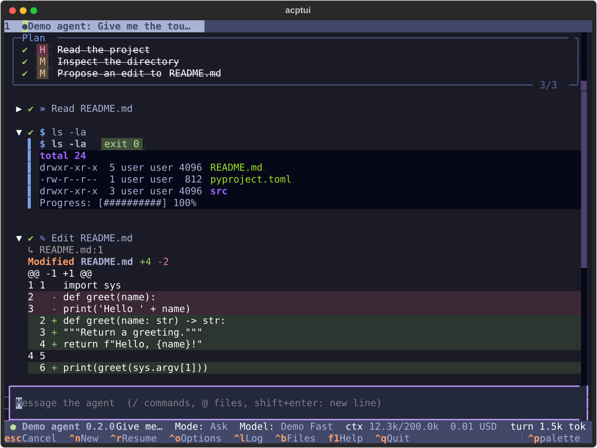

# acptui

[](https://pypi.org/project/acptui/)
[](https://pypi.org/project/acptui/)
[](https://pypi.org/project/acptui/)
[](https://pypi.org/project/acptui/)
[](https://pypi.org/project/acptui/)
[](https://pypi.org/project/acptui/)
[](https://pypi.org/project/acptui/)
[](https://github.com/phil65/acptui/releases)
[](https://github.com/phil65/acptui/graphs/contributors)
[](https://github.com/phil65/acptui/forks)
[](https://github.com/phil65/acptui/issues)
[](https://github.com/phil65/acptui/pulls)
[](https://github.com/phil65/acptui/watchers)
[](https://github.com/phil65/acptui/stars)
[](https://github.com/phil65/acptui)
[](https://github.com/phil65/acptui/commits)
[](https://github.com/phil65/acptui/releases)
[](https://github.com/phil65/acptui)
[](https://github.com/phil65/acptui)
[](https://codecov.io/gh/phil65/acptui/)
[](https://pyup.io/repos/github/phil65/acptui/)

[Read the documentation!](https://phil65.github.io/acptui/)

**acptui** is a terminal UI for AI coding agents that speak the
[Agent Client Protocol](https://agentclientprotocol.com) (ACP), **built on the
draft ACP v2** and nothing else. Talk to Claude Code, Codex or any other v2 agent in
your terminal: streaming Markdown, tool calls with diffs and live terminals,
permission prompts, plans, subagents, forms the agent asks you to fill in, session
history, modes and models.

- **Tabs**: several agents and sessions side by side (`ctrl+t`), each with its own
  process; the tab bar shows which one works or waits for you.
- **Images** drawn in the terminal (kitty graphics, Sixel, or half blocks anywhere).
- **Notifications and sounds** when an agent asks something or finishes while you look
  elsewhere (desktop or terminal notifications, terminal title).
- **Shell mode** (`!`): a real shell next to the agent; its output goes with your next
  prompt.
- **In the browser**: `acptui serve run claude`.
- **Markdown where ACP v2 allows it** (command, option, permission, subagent and login
  descriptions), plain text where it does not; agent HTML is never interpreted.

The protocol layer is [aclientp](https://github.com/phil65/aclientp)'s typed v2
client; the UI is [Textual](https://textual.textualize.io). In spirit it is close to
[toad](https://github.com/batrachianai/toad); see [differences](#differences-from-toad).



## Install

```bash
uv tool install acptui     # or: pipx install acptui
acptui                     # pick an agent
acptui run demo            # the bundled demo agent: no LLM, no API key
```

Python 3.13+.

## Usage

```bash
acptui                                   # agent picker (or `default_agent` from the config)
acptui run claude                        # an agent from the registry
acptui run -- my-agent --acp             # any command that speaks ACP v2 on stdio
acptui connect https://host/acp -H "Authorization: Bearer ${TOKEN}"   # Streamable HTTP
acptui connect wss://host/acp            # WebSocket
acptui run codex --resume SESSION_ID     # resume a session (with history replay)
acptui -o model=opus -o mode=plan run claude   # initial session options
acptui --add-dir ../lib --system-prompt "Be terse." run codex
acptui serve run demo                    # in the browser: http://localhost:8000
acptui options codex                     # print an agent's options and commands
acptui agents                            # the registry and what is installed
```

In the app: `enter` sends, `shift+enter` / `ctrl+j` adds a line, `/` completes the
agent's commands, `@` completes file paths (the files are attached), `escape`
cancels the turn, `shift+tab` switches the mode, `ctrl+o` shows mode / model /
other options, `ctrl+n` / `ctrl+r` / `ctrl+f` start, resume and fork sessions,
`ctrl+l` shows the agent's stderr and the protocol traffic, `ctrl+t` opens a new tab,
`alt+left` / `alt+right` switch tabs, `ctrl+p` opens the command palette (login,
providers, everything else) and `f1` the help.

## Supported agents

ACP v2 is a draft; agents get v2 support one by one. acptui negotiates the version in
`initialize` and stops with a clear message if the agent answers with another one.

| id | Agent | Command | ACP v2 |
| --- | --- | --- | --- |
| `claude` | Claude Code | `claude-agent-acp` | yes (0.108+) |
| `codex` | Codex | `codex-acp` | yes (2.7+) |
| `gemini` | Gemini CLI | `gemini --experimental-acp` | not yet |
| `opencode` | OpenCode | `opencode acp` | not yet (v1) |
| `agentpool` | AgentPool | `agentpool serve-acp` | yes (2.11+) |
| `demo` | Demo agent | `python -m acptui.demo` | yes |

The registry also has the agents from toad's list (Amp, Auggie, Copilot CLI, Cursor,
Goose, Kimi, Kiro, OpenHands, Mistral Vibe and more), whose v2 support is unknown yet:
`acptui agents` lists them all, and `i` in the picker shows an agent's details with
actions to install it and log in.

Add your own agents (or override these) in `config.toml` in the platform config
directory (`acptui config` prints the path):

```toml
default_agent = "codex"
theme = "tokyo-night"
diff_view = "auto"                 # unified, split or auto
system_prompt = "Prefer small commits."
additional_directories = ["~/src/shared"]

[agents.my-agent]
name = "My agent"
command = ["my-agent", "--acp"]
env = { MY_FLAG = "1" }

[agents.remote]
url = "https://example.com/acp"
headers = { Authorization = "Bearer ${MY_TOKEN}" }

[agent_options.claude]             # initial session config options
model = "opus"

[[mcp_servers]]                    # passed to every session (stdio or http)
name = "docs"
command = "docs-mcp"
```

## ACP v2 coverage

acptui implements the whole client side of ACP v2 (schema `v2.0.0-beta.4`): every
session update kind, all content blocks (text, images, audio, resource links,
embedded resources, skills), tool calls with diffs and agent-owned terminals,
permissions, form and URL elicitation, plans, config options (modes, models),
commands and skills, sessions (new, list, resume with replay, fork at cursors,
close, delete, archive, status, options, title), subagent sessions and messages
between sessions, auth (agent and terminal login, logout, status), LLM providers,
prompt suggestions, compactions, background work, usage and cost, MCP servers,
system prompts, additional directories and cancellation. The
[coverage table](https://phil65.github.io/acptui/spec-coverage/) maps each spec item
to the code and the test.

v2 moved file system access and command execution to the agent: there are no
`fs/*` or client-side `terminal/*` methods in v2. Terminals are agent-owned and
display-only; acptui renders them live and can cancel them.

## Differences from toad

acptui aims to have everything good in toad; the
[comparison](https://phil65.github.io/acptui/toad-comparison/) lists every toad feature
and where acptui stands.

- **ACP v2 only**, through aclientp's typed models end to end (toad speaks v1 with
  hand-written dicts). No v1 fallback.
- The full v2 client surface: subagents, elicitation, cursors and forking, providers,
  auth status, session archive / delete / status, prompt suggestions, compactions.
- Images are drawn; Markdown descriptions follow v2's rules.
- **Type safe**: `ty` reports nothing, no untyped code paths.
- No telemetry, no update check, no network calls of its own. A built-in demo agent
  shows every feature without an API key.

## License

AGPL-3.0-or-later, like toad. Some UI pieces are adapted from
[toad](https://github.com/batrachianai/toad) (Copyright (c) Will McGugan, AGPL-3.0);
see [NOTICE](NOTICE).
