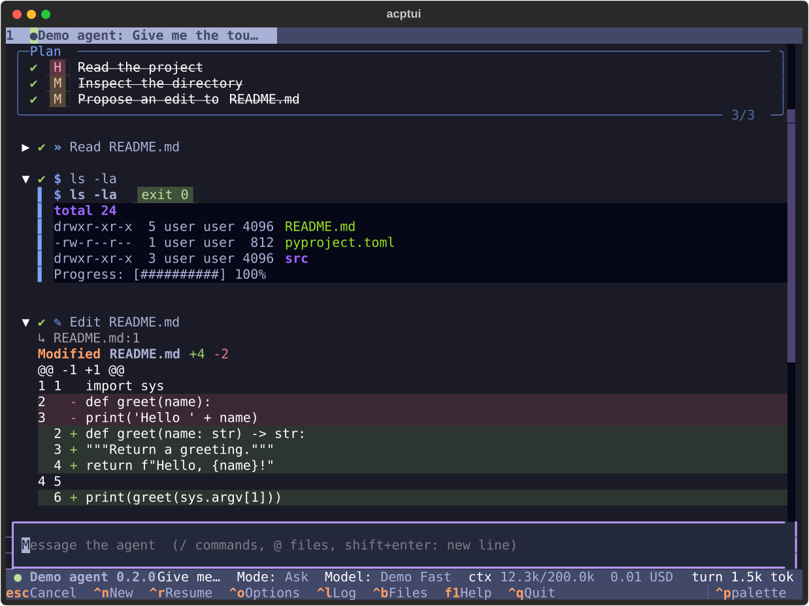
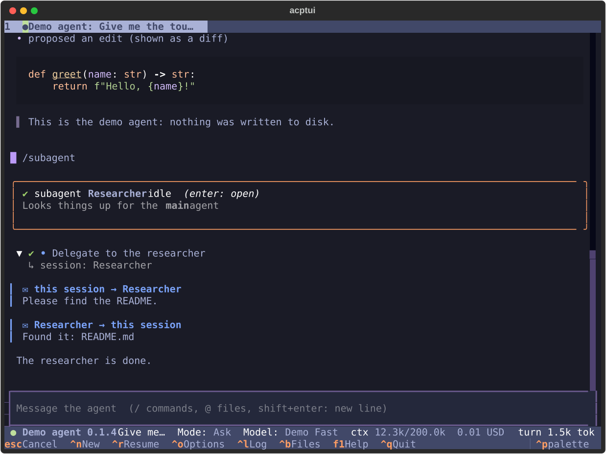
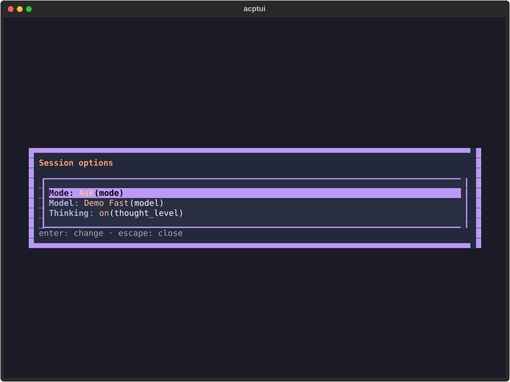

# Usage

## Starting

```bash
acptui                           # agent picker (or `default_agent` from the config)
acptui run claude                # a registry agent (`acptui agents` lists them)
acptui run demo                  # the bundled demo agent: no LLM, no API key
acptui run -- my-agent --acp     # any program speaking ACP v2 on stdio
acptui connect https://host/acp -H "Authorization: Bearer ${TOKEN}"
acptui connect wss://host/acp
```

Options go before the command:

| Option | Effect |
| --- | --- |
| `--cwd DIR` | Working directory of the session (default: the current one) |
| `-o ID=VALUE` | Initial session config option, e.g. `-o model=opus -o mode=plan` |
| `--add-dir DIR` | Additional workspace root (if the agent supports it) |
| `--system-prompt TEXT` | Extra system instructions (if the agent supports it) |
| `--system-prompt-mode append\|override` | Append to or replace the agent's instructions |
| `--config FILE` | Another config file |

`acptui run AGENT --resume SESSION_ID` resumes a session and replays its history.
`acptui options AGENT` prints the config options (with their ids and values) and the
commands an agent offers, without starting the UI.


## The session screen



The conversation shows user messages, the agent's streamed Markdown answer, its
thoughts (collapsed), plans, tool calls and notices. Tool calls show their status,
kind, title and locations; their content is text, diffs (unified or side by side,
syntax highlighted) and live terminals. `tab` moves the focus into the
conversation: `enter` on a tool call toggles its details, `r` shows its raw input
and output, `x` cancels it (if the agent allows it).

The status line shows the agent, the session title, whether the agent is working,
the account, background work, mode and model, the context window and the cost.

### Keys

| Key | Action |
| --- | --- |
| `enter` | Send (or accept a completion) |
| `shift+enter`, `ctrl+j` | New line |
| `/` | Complete the agent's commands and skills |
| `@` | Complete a path; the file is attached to the prompt |
| `tab` (empty prompt) | Take the agent's suggested next prompt |
| `up` / `down` | Prompt history |
| `escape` | Cancel the turn |
| `shift+tab` | Next mode |
| `ctrl+o` | Session options: mode, model, thought level, ... |
| `ctrl+n` | New session |
| `ctrl+r` | Resume a session (`d` delete, `a` archive, `h` show archived) |
| `ctrl+f` | Fork the session, whole or at a point the agent offers |
| `f2` | Rename the session |
| `ctrl+d` | Diff view: unified / split / auto |
| `ctrl+l` | Agent log: stderr, and `t` for the protocol traffic |
| `ctrl+p` | Command palette: everything above, login / logout, providers, option values |
| `f5` | Restart the agent |
| `f1` | Help |
| `ctrl+q` | Quit |

## Attachments

`@path` mentions (inside the working directory) are attached to the prompt: small
text files are embedded when the agent accepts embedded context, images and audio are
attached when it accepts them, anything else is sent as a resource link. Escape spaces
in paths with a backslash (`@my\ file.txt`); the completion does that for you.

## Permissions


The agent's options are buttons; number keys pick one, `y` the first "allow"
option, `n` the first "reject" option and `escape` rejects once. Tool calls show
their diff; commands show the command line and directory. If the agent withdraws the
request (it cancelled the turn), the dialog closes by itself.

## Forms and URLs


Agents can ask for structured input (elicitation): acptui builds a form from the
schema (text, choices, numbers, switches, multi-select) and checks required fields
and limits; `ctrl+s` submits, `escape` cancels. For URL requests (e.g. to sign in)
`o` opens the browser; the dialog closes when the agent reports completion.

## Subagents



Agents can run child sessions. They appear as a block in the conversation; `enter`
opens the child's conversation, `x` cancels its work (if allowed). Messages between
sessions are shown with their sender and recipient.

## Sessions, options and login



`ctrl+o` lists the agent's config options; modes and models are shown in the status
line. Initial values can be set per agent in the config (`[agent_options.ID]`) or
with `-o`. If the agent needs a login, acptui says so and the command palette offers
its login methods: "agent" methods log in through the agent, "terminal" methods run
the agent's login command in the terminal. LLM providers (where agents support it)
are configured from the palette too.

## Configuration

`config.toml` in the platform config directory (`acptui config` prints the path, the
`ACPTUI_CONFIG` environment variable overrides it):

```toml
default_agent = "codex"
theme = "tokyo-night"              # any Textual theme
diff_view = "auto"                 # unified, split or auto (split from 120 columns)
expand_thoughts = false
system_prompt = "Prefer small commits."
system_prompt_mode = "append"
additional_directories = ["~/src/shared"]

[agents.my-agent]                  # new agents, or overrides of built-in ones
name = "My agent"
command = ["my-agent", "--acp"]
env = { MY_FLAG = "1" }            # ${VAR} expands from the environment
options = { model = "fast" }

[agents.remote]
url = "https://example.com/acp"    # http(s):// = Streamable HTTP, ws(s):// = WebSocket
headers = { Authorization = "Bearer ${MY_TOKEN}" }

[agent_options.claude]
model = "opus"

[[mcp_servers]]                    # passed to sessions of agents that support the transport
name = "docs"
command = "docs-mcp"               # resolved on PATH
args = ["--stdio"]

[[mcp_servers]]
name = "search"
url = "https://example.com/mcp"
headers = { "X-API-Key" = "${SEARCH_KEY}" }
```
